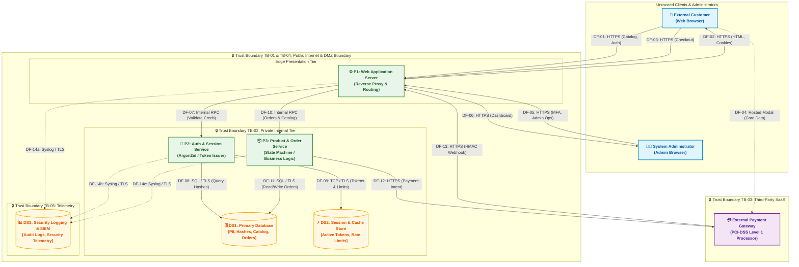

# SecureShop Threat Model & Security Hardening Assessment

[](https://github.com/)
[](https://csrc.nist.gov/publications/detail/sp/800-30/rev-1/final)
[](https://owasp.org/)
[](https://edvyro.com/)

An enterprise-grade, design-level threat model and defensive hardening specification for **SecureShop**, a fictional e-commerce web application. Developed as an engineering portfolio deliverable for the **EdVyro Cybersecurity Internship Program**.

---

## 📌 Table of Contents

- [1. Executive Summary & Project Overview](#1-executive-summary--project-overview)
- [2. Problem Statement & Business Context](#2-problem-statement--business-context)
- [3. Project Objectives](#3-project-objectives)
- [4. System Architecture & Component Interaction](#4-system-architecture--component-interaction)
- [5. Threat Modeling Methodology (STRIDE)](#5-threat-modeling-methodology-stride)
- [6. Summary of Identified Threats](#6-summary-of-identified-threats)
- [7. Risk Prioritization & Evaluation Method](#7-risk-prioritization--evaluation-method)
- [8. Security Hardening Roadmap](#8-security-hardening-roadmap)
- [9. Repository Structure](#9-repository-structure)
- [10. Instructions for Viewing the Diagram](#10-instructions-for-viewing-the-diagram)
- [11. Scope, Assumptions & Limitations](#11-scope-assumptions--limitations)
- [12. References & Authoritative Standards](#12-references--authoritative-standards)
- [13. Beginner-Friendly Review Guide & Mentor Q&A](#13-beginner-friendly-review-guide--mentor-qa)
- [14. Step-by-Step GitHub Submission Guide for EdVyro](#14-step-by-step-github-submission-guide-for-edvyro)

---

## 1. Executive Summary & Project Overview

Modern web applications operate in hostile, internet-facing environments. Vulnerabilities introduced during architectural design are exponentially more expensive to remediate post-launch than those discovered during pre-implementation modeling.

This project delivers a complete, design-level cybersecurity assessment of **SecureShop**, an e-commerce platform that enables customers to browse products, register, log in, manage carts, place orders, and review past purchases, while granting administrators management capabilities over inventory, pricing, and order fulfillment. 

The assessment:
- Establishes a rigorous **Level 1 Data Flow Diagram (DFD)** identifying components, data flows, and trust boundaries.
- Executes a systematic **STRIDE threat analysis** uncovering 15 granular threat scenarios across authentication, business logic, databases, and third-party APIs.
- Quantifies risk using a **Likelihood × Impact matrix (1–25 scale)** with clear qualitative severity bands (Low, Medium, High, Critical).
- Constructs a **prioritized Security Hardening Checklist** (P1 Critical, P2 Important, P3 Additional) with concrete verification methods.
- Provides machine-readable datasets (`risk-register.csv`) for GRC and audit readiness.

---

## 2. Problem Statement & Business Context

E-commerce web applications present high-value targets for cyber adversaries because they handle sensitive Customer Personally Identifiable Information (PII), authentication credentials, and transactional funds. 

Common real-world failures include:
1. **Broken Access Control & IDOR**: Allowing users to access other customers' private orders or call admin APIs without authorization.
2. **Client-Side Pricing & Cart Tampering**: Trusting price totals submitted directly by browsers, resulting in fraudulent purchases.
3. **Third-Party Webhook Forgery**: Accepting unauthenticated payment notifications that mark unpaid orders as fulfilled.
4. **SQL Injection & Data Leaks**: Exposing underlying relational databases to arbitrary query manipulation and massive data breaches.
5. **Session Hijacking & Brute Force**: Lacking rate limiting and cookie security attributes, leading to mass account takeover.

Without proactive threat modeling, organizations deploy vulnerable systems and rely solely on reactive patching after a catastrophic breach has already occurred.

---

## 3. Project Objectives

1. **Architectural Decomposition**: Break down SecureShop into 9 distinct entities, processes, and data stores with 14 directional data flows.
2. **Trust Boundary Mapping**: Define explicit perimeters where data transitions between untrusted public internet, edge presentation, internal private microservices, third-party clouds, and security telemetry.
3. **STRIDE Threat Identification**: Uncover at least two realistic threat scenarios for every letter of the STRIDE mnemonic (Spoofing, Tampering, Repudiation, Information Disclosure, Denial of Service, Elevation of Privilege).
4. **Risk Quantification & Prioritization**: Calculate mathematical risk scores to rank risks objectively and justify remediation urgency.
5. **Defense-in-Depth Hardening**: Produce 22 prioritized security controls (P1, P2, P3) mapped directly to identified threats with verifiable test steps.
6. **Academic Rigor & Mentorship**: Provide clear technical explanations, interview-ready Q&As, and a beginner-friendly cybersecurity glossary.

---

## 4. System Architecture & Component Interaction

The SecureShop architecture follows a modern three-tier web application model with edge reverse proxying, internal private services, persistent relational storage, and third-party SaaS payment integration.

### Core Architectural Entities & Processes:
- **Customer Browser**: Public user interface for registration, catalog browsing, cart checkout, and order history.
- **Administrator Browser**: Privileged management interface for product catalog CRUD and order fulfillment.
- **P1: Web Application Server**: Edge reverse proxy, TLS termination point, HTTP security header injector, and request router.
- **P2: Auth & Session Management Service**: Handles credential hashing (Argon2id/bcrypt), TOTP MFA, session tokens, and rate limits.
- **P3: Product & Order Processing Service**: Executes checkout business logic, price verification, order state machine, and payment intent dispatch.
- **DS1: Primary Relational Database**: Encrypted storage for PII, password hashes, products, orders, and transactional state.
- **DS2: Session & Cache Store**: Low-latency in-memory cache (Redis) for active session tokens and sliding-window rate limits.
- **DS3: Security Logging & SIEM**: Immutable repository for audit logs, access telemetry, and security alerts.
- **External Payment Gateway**: PCI-DSS Level 1 processor capturing card data via hosted iframes (SAQ A model).

### Data Flow Diagram (Mermaid Source)



---

## 5. Threat Modeling Methodology (STRIDE)

This assessment applies the **STRIDE** methodology (Microsoft / OWASP) to systematically evaluate failure modes across every component and data flow:

| Category | Security Goal | Description | SecureShop Target |
| :--- | :--- | :--- | :--- |
| **S — Spoofing** | Authentication | Pretending to be someone else | Login credential stuffing, session hijacking, webhook forgery |
| **T — Tampering** | Integrity | Modifying data without authorization | Client-side price tampering, SQL injection, order state manipulation |
| **R — Repudiation** | Non-Repudiation | Denying an action occurred without proof | Disputing order placement, admin modifying prices without audit trail |
| **I — Information Disclosure** | Confidentiality | Exposing sensitive data to unauthorized actors | IDOR leaking order history, verbose debug stack traces, cleartext HTTP |
| **D — Denial of Service** | Availability | Exhausting system resources | Wildcard catalog search DoS, registration/login auth flooding |
| **E — Elevation of Privilege** | Authorization | Gaining unauthorized higher capabilities | Customers invoking `/api/admin/*`, JWT role claim forgery |

---

## 6. Summary of Identified Threats

15 distinct design-level threats were identified and mapped across the system:

| Threat ID | Category | Component | Scenario Summary | Severity |
| :--- | :--- | :--- | :--- | :---: |
| `THREAT-S-01` | Spoofing | P2: Auth Service | Credential stuffing and automated brute force against login | **High (16)** |
| `THREAT-S-02` | Spoofing | P1: Web App | Session hijacking via stolen cookies lacking security attributes | **High (12)** |
| `THREAT-S-03` | Spoofing | P1: Web App | Synthetic payment webhook spoofing payment gateway | **Critical (20)** |
| `THREAT-T-01` | Tampering | P3: Order Service | Client-side shopping cart price and quantity manipulation | **High (16)** |
| `THREAT-T-02` | Tampering | DS1: Database | SQL Injection via catalog search query concatenation | **Critical (20)** |
| `THREAT-T-03` | Tampering | P3: Order Service | In-transit parameter tampering altering order fulfillment state | **Medium (9)** |
| `THREAT-R-01` | Repudiation | P3: Order Service | Customer disputes order placement due to missing transactional logs | **Medium (9)** |
| `THREAT-R-02` | Repudiation | P3: Order Service | Disgruntled admin alters product prices without immutable audit logs | **High (10)** |
| `THREAT-I-01` | Information Disclosure | P3: Order Service | IDOR leaking other customers' private PII and order history | **High (16)** |
| `THREAT-I-02` | Information Disclosure | P1: Web App | Verbose error stack traces exposing database schema and file paths | **Medium (6)** |
| `THREAT-I-03` | Information Disclosure | Edge Network | Eavesdropping on unencrypted HTTP traffic or missing HSTS | **High (12)** |
| `THREAT-D-01` | Denial of Service | P3: Order Service | Unbounded wildcard database search queries causing CPU exhaustion | **Medium (9)** |
| `THREAT-D-02` | Denial of Service | P2: Auth Service | Automated registration and login flood exhausting database pool | **High (12)** |
| `THREAT-E-01` | Elevation of Privilege | P1 & P3: Web App | Broken access control permitting regular customers to call admin APIs | **Critical (20)** |
| `THREAT-E-02` | Elevation of Privilege | P2: Auth Service | JWT or session role claim manipulation granting superuser rights | **High (15)** |

*For complete attack scenarios and consequences, see [docs/03-threat-analysis.md](docs/03-threat-analysis.md).*

---

## 7. Risk Prioritization & Evaluation Method

Risk is evaluated using a semi-quantitative Likelihood-Impact matrix:

$$\text{Risk Score} = \text{Likelihood} \times \text{Impact} \quad (\text{Scale: } 1 - 25)$$

### Qualitative Scoring Scales:
- **Likelihood (1–5)**: 1 = Rare, 2 = Unlikely, 3 = Moderate, 4 = Likely, 5 = Almost Certain.
- **Impact (1–5)**: 1 = Negligible, 2 = Minor, 3 = Moderate, 4 = Major, 5 = Severe / Catastrophic.

### Project Severity Bands:
- 🔴 **Critical (17–25)**: Immediate blocker. Requires architectural redesign or mandatory blocking controls before release.
- 🟠 **High (10–16)**: Urgent remediation. Addressed during current milestone before public launch.
- 🟡 **Medium (5–9)**: Planned remediation. Scheduled for standard engineering cycle.
- 🟢 **Low (1–4)**: Routine maintenance or accepted residual risk.

> [!NOTE]
> These bands are project-defined qualitative scoring criteria designed to prioritize e-commerce security controls, not a universal legal standard.

### Risk Register Summary

```
Total Risks Evaluated: 15
├── 🔴 Critical Severity (17-25): 3 (Webhook Spoofing, SQLi, Broken Admin Access)
├── 🟠 High Severity (10-16):     8 (Credential Stuffing, Session Hijacking, Cart Tampering, IDOR, etc.)
└── 🟡 Medium Severity (5-9):     4 (Parameter Tampering, Repudiation, Verbose Errors, Search DoS)
```

*For the complete risk ledger, see [docs/04-risk-register.md](docs/04-risk-register.md) and [risk-register.csv](risk-register.csv).*

---

## 8. Security Hardening Roadmap

The hardening roadmap defines 22 engineering controls categorized by operational priority:

### Priority 1 — Critical Security Protections (Mandatory Pre-Launch)
- **`SEC-CTRL-01`**: Strong Authentication & Argon2id/bcrypt Hashing (Breach screening, admin MFA).
- **`SEC-CTRL-02`**: Server-Side Role-Based Access Control (Default-deny RBAC on `/api/admin/*`).
- **`SEC-CTRL-03`**: Anti-IDOR Object Ownership Validation (`order.user_id === session.user_id`, UUIDv4).
- **`SEC-CTRL-04`**: Secure Session Handling (`HttpOnly`, `Secure`, `SameSite=Strict`, 30-min idle timeout).
- **`SEC-CTRL-05`**: Cryptographic Secrets Management (External vault, zero hardcoded secrets).
- **`SEC-CTRL-06`**: Database Least Privilege & Network Segmentation (Private VPC subnet, read/write user).
- **`SEC-CTRL-07`**: HTTPS & TLS 1.3 Enforcement (Port 80 redirect, HSTS 2-year preload).
- **`SEC-CTRL-08`**: Cryptographic Payment Webhook Verification (HMAC-SHA256 signature verification).

### Priority 2 — Important Protections (Standard Baseline)
- **`SEC-CTRL-09`**: Strict Input Validation & Allowlisting (Zod/Joi schema validation).
- **`SEC-CTRL-10`**: Universal Parameterized Queries (Elimination of raw SQL concatenation).
- **`SEC-CTRL-11`**: Cross-Site Request Forgery (CSRF) Defense (Synchronizer tokens & SameSite).
- **`SEC-CTRL-12`**: Comprehensive HTTP Security Headers (CSP, X-Frame-Options, nosniff).
- **`SEC-CTRL-13`**: Multi-Tiered Sliding-Window Rate Limiting (Redis rate limiter on auth and search).
- **`SEC-CTRL-14`**: Standardized Safe Error Handling (Opaque error IDs, no stack traces to clients).
- **`SEC-CTRL-15`**: Centralized Immutable Audit Logging (Append-only SIEM streaming with UTC timestamps).
- **`SEC-CTRL-16`**: Automated Dependency Updates & Patch Management (Dependabot/Snyk in CI/CD).

### Priority 3 — Additional Hardening (Operational Maturity)
- **`SEC-CTRL-17`**: Real-Time Security Monitoring & SIEM Alerting (Threshold alerts on auth spikes).
- **`SEC-CTRL-18`**: Automated Encrypted Backups & Disaster Recovery Drills (Nightly snapshots, AES-256).
- **`SEC-CTRL-19`**: Baseline Configuration Reviews & CIS Benchmark Hardening (Hardened OS/containers).
- **`SEC-CTRL-20`**: CI/CD Static Application Security Testing (SAST) & Secret Scanning.
- **`SEC-CTRL-21`**: Periodic Administrative Access Reviews (Quarterly permission re-authorizations).
- **`SEC-CTRL-22`**: Routine Dynamic Security Testing & Annual Penetration Testing.

*For full implementation guidance and verification methods, see [docs/05-hardening-checklist.md](docs/05-hardening-checklist.md).*

---

## 9. Repository Structure

```
secure-shop-threat-model/
│
├── README.md                      # Executive overview, methodology, navigation & GitHub submission guide
├── risk-register.csv              # Machine-readable tabular risk register (13 standard attributes)
│
├── docs/
│   ├── 01-project-scope.md        # Scope, assets, assumptions, methodology, and beginner glossary
│   ├── 02-system-architecture.md  # Detailed component decomposition, trust boundaries, data flow matrix
│   ├── 03-threat-analysis.md      # Comprehensive STRIDE threat analysis (15 granular threat scenarios)
│   ├── 04-risk-register.md        # Risk scoring matrix, severity bands, and full risk ledger
│   └── 05-hardening-checklist.md  # Prioritized security controls (P1, P2, P3) with verification steps
│
├── diagrams/
│   ├── threat-model.mmd           # Maintainable Mermaid DFD Level 1 source code
│   └── threat-model.png           # High-resolution rendered architectural diagram
│
└── references/
    └── resources.md               # Trustworthy standards (OWASP, NIST SP 800-30/53, PCI-DSS)
```

---

## 10. Instructions for Viewing the Diagram

The Data Flow Diagram is maintained in two formats:

1. **Native GitHub Markdown (Mermaid)**:
   - When viewing this `README.md` or `diagrams/threat-model.mmd` on GitHub, GitHub automatically renders the Mermaid diagram natively in your browser.
2. **High-Resolution Graphical Image (`diagrams/threat-model.png`)**:
   - Located at [`diagrams/threat-model.png`](diagrams/threat-model.png).
   - Can be opened in any image viewer, browser, or markdown previewer.
3. **Rendering or Editing Locally**:
   - To edit or view live in VS Code, install the extension **Markdown Preview Mermaid Support** or **Mermaid Chart**.
   - To render to SVG/PNG via CLI:
     ```bash
     npx @mermaid-js/mermaid-cli -i diagrams/threat-model.mmd -o diagrams/threat-model.png
     ```
   - Alternatively, copy the contents of `diagrams/threat-model.mmd` into the official online editor at [mermaid.live](https://mermaid.live).

---

## 11. Scope, Assumptions & Limitations

- **Educational Design Assessment**: SecureShop is a **fictional web application model**. All evaluations represent prospective design-level threat analysis and defensive engineering planning.
- **No Live Penetration Testing**: No claims are made that a live server was subjected to intrusive scanning or exploitation.
- **Status of Controls**: In accordance with professional engineering integrity, all security controls are documented as `Proposed` or `Not implemented` until empirical verification data exists.
- **Payment Offloading Assumption**: All payment card transactions are assumed to be delegated to an external PCI-DSS Level 1 payment processor using hosted iframes (SAQ A compliance model). SecureShop never stores raw credit card numbers.

---

## 12. References & Authoritative Standards

This assessment is grounded in official, peer-reviewed industry standards:
- **OWASP Threat Modeling Cheat Sheet**: [Reference Link](https://cheatsheetseries.owasp.org/cheatsheets/Threat_Modeling_Cheat_Sheet.html)
- **Microsoft STRIDE Methodology**: [Reference Link](https://learn.microsoft.com/en-us/previous-versions/commerce-server/ee823878(v=cs.20))
- **NIST SP 800-30 Rev. 1 (*Conducting Risk Assessments*)**: [Reference Link](https://csrc.nist.gov/publications/detail/sp/800-30/rev-1/final)
- **OWASP Top 10:2021**: [Reference Link](https://owasp.org/Top10/)
- **OWASP Application Security Verification Standard (ASVS v4.0.3)**: [Reference Link](https://owasp.org/www-project-application-security-verification-standard/)
- **PCI-DSS v4.0 (Payment Card Industry Data Security Standard)**: [Reference Link](https://www.pcisecuritystandards.org/document_library/)

*For annotated summaries of how each standard supports this assessment, see [references/resources.md](references/resources.md).*

---

## 13. Beginner-Friendly Review Guide & Mentor Q&A

### 13.1 How to Review This Project
If you are evaluating this project for an internship milestone, technical interview, or peer review:
1. **Start with the Diagram (`diagrams/threat-model.mmd`)**: Verify that all components, trust boundaries, and numbered data flows (`DF-01` through `DF-14`) make logical architectural sense.
2. **Trace a Threat (`docs/03-threat-analysis.md`)**: Pick one threat (e.g., `THREAT-S-03: Webhook Spoofing`) and review its attack scenario and consequences.
3. **Check the Risk Register (`docs/04-risk-register.md`)**: Confirm that the threat has an associated Risk ID (`RISK-03`), that the mathematical score ($4 \times 5 = 20$) correctly maps to Critical severity, and that it is present in `risk-register.csv`.
4. **Inspect the Mitigation (`docs/05-hardening-checklist.md`)**: Verify that the risk maps to control `SEC-CTRL-08` with concrete HMAC-SHA256 implementation guidance and a practical verification test.

### 13.2 Key Interview Questions & Sample Answers

**Q1: Why conduct a threat model during design instead of waiting for code to be written and running a penetration test?**
> *Answer:* Remediating an architectural flaw after code deployment costs up to 30 to 60 times more than addressing it during design. For example, if you design a system where the client calculates order totals, retrofitting server-side price validation later requires rewriting the database layer, API contracts, mobile apps, and frontend UI. Threat modeling shifts security left, preventing structural vulnerabilities before a single line of code is written.

**Q2: What is the primary difference between a Vulnerability and a Threat?**
> *Answer:* A **threat** is a potential event or actor that could cause harm (e.g., an attacker trying to purchase items for \$0.01). A **vulnerability** is a specific weakness in the system that makes the threat possible (e.g., the checkout API accepting client-submitted price parameters without database validation).

**Q3: How does PCI-DSS SAQ A protect an e-commerce startup?**
> *Answer:* PCI-DSS SAQ A applies to e-commerce merchants who completely outsource cardholder data processing to a PCI-DSS validated third-party payment processor via hosted fields or redirects. Because raw card numbers never touch the merchant's servers, the merchant is exempt from hundreds of costly infrastructure controls, and customers are protected even if the merchant's database is compromised.

---

## 14. Step-by-Step GitHub Submission Guide for EdVyro

Follow these exact steps to push this project to your personal GitHub account and submit the link for your EdVyro internship evaluation.

### Step 1: Open Terminal in the Project Directory
Open PowerShell or your preferred terminal in `F:\threat_model`:
```powershell
cd F:\threat_model
```

### Step 2: Initialize Git Repository
```powershell
git init -b main
```

### Step 3: Verify All Deliverables are Present
```powershell
git status
```
You should see:
- `README.md`
- `risk-register.csv`
- `docs/` (5 files)
- `diagrams/` (2 files)
- `references/` (1 file)

### Step 4: Stage and Commit the Files
```powershell
git add .
git commit -m "feat: complete SecureShop threat model and security hardening assessment for EdVyro internship"
```

### Step 5: Create a New Repository on GitHub
1. Log into your [GitHub account](https://github.com/).
2. Click the **+** icon in the top right and select **New repository**.
3. Set the **Repository name** to: `secure-shop-threat-model`.
4. Set the visibility to **Public** (required for EdVyro evaluators to access your work).
5. **Do NOT** initialize with a README, .gitignore, or license (these already exist locally).
6. Click **Create repository**.

### Step 6: Link Local Repository to GitHub and Push
Copy the repository URL provided by GitHub (e.g., `https://github.com/<your-username>/secure-shop-threat-model.git`) and run:
```powershell
git remote add origin https://github.com/<your-username>/secure-shop-threat-model.git
git push -u origin main
```

### Step 7: Preview and Validate on GitHub
1. Navigate to your repository URL on GitHub.
2. Confirm that the `README.md` renders properly, including the embedded Mermaid diagram.
3. Open `docs/04-risk-register.md` and `risk-register.csv` to ensure all 13 columns render cleanly in tabular format.
4. Verify that `diagrams/threat-model.png` is visible and accessible.

### Step 8: Copy Repository Link for EdVyro Submission
Copy the public repository URL from your browser address bar:
`https://github.com/<your-username>/secure-shop-threat-model`
Submit this URL into your **EdVyro Internship Portal** under the project submission form.
"# threat_model" 
