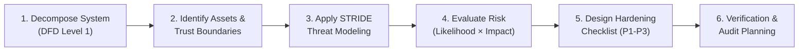

# 01. Project Scope & Assessment Charter: SecureShop Threat Model

## Executive Summary & Document Control

| Attribute | Details |
| :--- | :--- |
| **Project Title** | Threat Model and Secure Configuration of a Sample Web Application |
| **System Name** | SecureShop E-Commerce Platform |
| **Document Version** | 1.0.0 (Pre-Implementation Architectural Baseline) |
| **Author / Role** | Cybersecurity Engineering Intern (EdVyro Internship Program) |
| **Supervision / Context** | Senior Application Security & Threat Modeling Assessment |
| **Status** | Approved Design-Level Assessment Baseline |

---

## 1. Project Overview

Modern web applications operate in hostile, internet-facing environments where threat actors continuously exploit design flaws, implementation vulnerabilities, and insecure configurations. The **SecureShop Threat Model** project delivers a comprehensive design-level cybersecurity assessment of **SecureShop**, a fictional full-stack e-commerce web application.

This assessment analyzes the software architecture before full-scale production deployment to identify potential security exposures, map trust boundaries, uncover threats using the **STRIDE** methodology, quantify risks through a reproducible likelihood-impact matrix, and formulate an actionable, prioritized defense-in-depth hardening roadmap.

> [!IMPORTANT]
> **Academic & Design-Level Assessment Disclaimer:**
> **SecureShop is a fictional application model.** This assessment is conducted entirely at the design, architecture, and procedural specification levels based on documented architectural assumptions. No real-world web application was subjected to invasive penetration testing, live vulnerability scanning, or dynamic exploitation, and no security controls are reported as verified on a production infrastructure.

---

## 2. Assessment Objectives

The primary objectives of this cybersecurity assessment are:

1. **Deconstruct Application Architecture**: Break down SecureShop into distinct architectural components, processes, data stores, external dependencies, and network data flows.
2. **Establish Explicit Trust Boundaries**: Define and document where control privileges, execution contexts, and network perimeters transition between untrusted, semi-trusted, and trusted domains.
3. **Execute Comprehensive STRIDE Threat Identification**: Categorize design-level threats across Spoofing, Tampering, Repudiation, Information Disclosure, Denial of Service, and Elevation of Privilege.
4. **Quantify and Prioritize Risk**: Develop a transparent, mathematically grounded Risk Register calculating Risk Scores ($Likelihood \times Impact$) to classify risks into Low, Medium, High, and Critical severity tiers.
5. **Formulate a Defense-in-Depth Hardening Checklist**: Provide a three-tiered security control specification (P1: Critical, P2: Important, P3: Additional) detailing implementation guidelines and validation criteria.
6. **Produce GitHub-Ready Technical Documentation**: Deliver a modular, auditable, and reproducible engineering repository for peer review and internship evaluation.

---

## 3. Application Core Functionality

SecureShop delivers an essential e-commerce shopping experience for two distinct classes of users:

### 3.1 Customer Functions
- **Self-Service Account Management**: User registration, credential-based authentication, password resets, and profile management.
- **Product Catalog Browsing**: Public searching, filtering, and browsing of merchandise catalog, product descriptions, reviews, and real-time inventory counts.
- **Cart & Checkout Processing**: Adding items to a temporary shopping cart, calculating subtotals/taxes/shipping, and submitting purchase orders.
- **Offloaded Payment Processing**: Transitioning to a secure payment modal or hosted checkout hosted by an external PCI-DSS Level 1 payment gateway.
- **Order History & Invoicing**: Querying historical purchase orders, fulfillment status, and receipt records.

### 3.2 Administrator Functions
- **Privileged Administrative Access**: Multi-factor authenticated login restricted to authorized operational staff.
- **Product & Inventory CRUD**: Creating, reading, updating, and disabling product catalog listings, SKU quantities, and pricing structures.
- **Order Fulfillment Management**: Reviewing inbound customer orders, updating shipping and fulfillment stages, and authorizing refunds.
- **Operational Auditing**: Viewing administrative audit logs for compliance and accountability.

---

## 4. Assets to Protect

Assets are the high-value data, computational processes, and business properties that SecureShop must protect against unauthorized access, destruction, tampering, or downtime.

| Asset ID | Asset Name | Description & Classification | Primary Business & Security Impact |
| :--- | :--- | :--- | :--- |
| **AST-01** | **Customer Personally Identifiable Information (PII)** | Names, physical shipping addresses, phone numbers, and email addresses. (*Confidential*) | Regulatory fines (GDPR, CCPA), loss of customer trust, legal liability. |
| **AST-02** | **Authentication Credentials** | Password hashes, cryptographic salts, password reset tokens, and MFA secrets. (*Restricted*) | Account takeover (ATO), systemic data breaches, lateral movement. |
| **AST-03** | **Active Session Identifiers & JWTs** | Cryptographic session cookies, Bearer tokens, and refresh tokens. (*Restricted*) | Real-time session hijacking, unauthorized transaction placement. |
| **AST-04** | **Payment Gateway Tokens & Webhooks** | Ephemeral payment intent IDs, charge tokens, and webhook HMAC signing secrets. (*Restricted*) | Fraudulent order fulfillment, payment evasion, revenue loss. |
| **AST-05** | **Order & Financial Transaction Records** | Order line items, billing receipts, tax computations, and shipping logs. (*Confidential*) | Inaccurate tax reporting, unauthorized disclosure of consumer shopping habits. |
| **AST-06** | **Product Catalog & Pricing Integrity** | Database records specifying product prices, discounts, and inventory balances. (*Internal Integrity*) | Financial loss through price manipulation, order fraud, inventory sabotage. |
| **AST-07** | **Application Availability & Compute Services** | Web server compute instances, database connections, and search endpoints. (*Availability*) | Inability of customers to browse or purchase, leading to immediate revenue loss. |
| **AST-08** | **Security Audit Logs & Telemetry** | Access logs, authentication event logs, transaction traces, and SIEM records. (*High Integrity*) | Inability to perform incident response or forensic non-repudiation. |

---

## 5. Security Assumptions & Baseline Context

The SecureShop assessment is constructed on the following explicit architectural and organizational assumptions:

1. **Third-Party Payment Delegation (PCI-DSS SAQ A Model)**:
   SecureShop **never** receives, processes, transmits, or stores raw Primary Account Numbers (PAN / credit card numbers) or Card Verification Values (CVV) on its application servers or database. All payment handling is delegated entirely to an external, PCI-DSS Level 1 certified payment gateway (e.g., Stripe, PayPal) via client-side hosted iframes/redirects.
2. **Perimeter Transport Layer Security (TLS)**:
   All incoming client and administrative traffic traverses a reverse proxy / Web Application Firewall (WAF) enforcing TLS 1.3 encryption in transit with HTTP Strict Transport Security (HSTS).
3. **Network Segmentation**:
   The internal database, session cache, and internal backend services reside within a private Virtual Private Cloud (VPC) subnet with no direct public internet exposure.
4. **Credential Storage Baseline**:
   Passwords are never stored in plaintext. They are processed using salted, adaptive cryptographic key derivation functions (e.g., Argon2id or bcrypt).
5. **No Production Hardware/Cloud Infrastructure Exists**:
   Because SecureShop is a design-level fictional model, all server environments, microservices, and network interfaces referenced represent target engineering specifications rather than provisioned cloud infrastructure.

---

## 6. Scope and Limitations

### 6.1 In-Scope Components
- **Client Tier**: Web browser interactions for both Customers and Administrators.
- **Edge & Presentation Tier**: Reverse proxy, Web Application server, request routing, and view presentation.
- **Internal Service Tier**: Authentication & Session Management service, Product & Order Processing service.
- **Data Persistence Tier**: Relational Database schemas, caching layers, and session stores.
- **Third-Party Integrations**: Inbound webhook processing and outbound payment intent dispatching with external payment gateways.
- **Security Telemetry**: In-flight security event logging, audit trails, and monitoring integration.

### 6.2 Out-of-Scope Elements
- Physical security of data center hosting facilities.
- Internal infrastructure, network routing, or security controls of the external third-party payment gateway.
- End-user endpoint security (e.g., malware or keyloggers installed on a customer's personal laptop).
- Detailed source code review or line-by-line syntax auditing (focus is architectural and threat modeling).
- Live penetrative attacks, denial of service stress tests, or actual network vulnerability exploitation.

---

## 7. Assessment Methodology

The assessment adopts an industry-standard, multi-phase threat modeling and risk management workflow synthesized from **Microsoft STRIDE**, **OWASP Threat Modeling Guidance**, and **NIST SP 800-30 Rev. 1**:

1. **Architecture Decomposition**: Translating application requirements into a Level 1 Data Flow Diagram (DFD) identifying all entities, processes, data stores, and data flows.
2. **Trust Boundary Mapping**: Determining where data crosses between different security levels.
3. **STRIDE Threat Identification**: Systematically questioning every component and data flow against the six STRIDE failure modes:
   - **S**poofing identity.
   - **T**ampering with data.
   - **R**epudiation of actions.
   - **I**nformation disclosure.
   - **D**enial of service.
   - **E**levation of privilege.
4. **Risk Quantification**: Assigning 1–5 scores for Likelihood and Impact to derive qualitative Risk Scores ($1–25$) and categorizing severity into Low, Medium, High, or Critical bands.
5. **Control Engineering**: Establishing prioritized security controls (Priority 1: Critical, Priority 2: Important, Priority 3: Additional) addressing all identified high-severity threats.
6. **Verification Definition**: Formulating concrete auditing, testing, and verification procedures for each security control.

---

## 8. Expected Project Deliverables

| Deliverable # | Artifact Path | Core Content & Objective |
| :--- | :--- | :--- |
| **01** | `docs/01-project-scope.md` | Assessment scope, objectives, assets, assumptions, methodology, and beginner glossary. |
| **02** | `docs/02-system-architecture.md` | In-depth component breakdown, data flow matrix (DF-01 to DF-14), and trust boundaries. |
| **03** | `docs/03-threat-analysis.md` | Systematic STRIDE threat analysis covering 14+ granular threat scenarios. |
| **04** | `docs/04-risk-register.md` | Comprehensive risk assessment matrix, severity bands, and risk prioritization rationale. |
| **05** | `risk-register.csv` | Machine-readable tabular risk register containing all 13 required data attributes. |
| **06** | `docs/05-hardening-checklist.md` | Prioritized security hardening checklist (P1, P2, P3) with implementation and verification methods. |
| **07** | `diagrams/threat-model.mmd` | Complete, maintainable Mermaid source code for the Level 1 Data Flow Diagram. |
| **08** | `diagrams/threat-model.png` | Rendered high-resolution graphical diagram with color-coded boundaries and components. |
| **09** | `references/resources.md` | Grounded, authoritative cybersecurity resources (OWASP, NIST, Microsoft, PCI-DSS). |
| **10** | `README.md` | Executive project presentation, methodology overview, navigation tree, and GitHub submission instructions. |

---

## 9. Beginner-Friendly Mentorship Section

### 9.1 Purpose of the Scope Document
In real-world cybersecurity consulting, a security assessment conducted without a formal scope is dangerous. It risks scope creep, legal ambiguity, and wasted engineering effort. The **Project Scope & Charter** establishes the rules of engagement, declares what is protected, outlines key assumptions, and prevents misunderstandings between engineering teams and security auditors.

### 9.2 Why It Matters
Without an accurate scope:
- Security engineers might waste time evaluating third-party payment infrastructure that they have no authorization or ability to modify.
- Critical assets (like customer PII or password hashes) might be overlooked during threat analysis.
- The organization cannot measure whether the assessment fulfilled its business requirements.

### 9.3 How It Was Created
1. Analyzed the business workflow of a modern e-commerce web application.
2. Formulated a data inventory detailing sensitive assets (PII, credentials, payment tokens).
3. Drafted explicit boundaries separating customer responsibilities, internal application services, and external SaaS providers.
4. Grounded the assessment approach in NIST SP 800-30 Rev. 1 risk principles.

### 9.4 How to Review This Document
When reviewing this scope document:
- Check whether every asset listed has a clear business classification.
- Confirm that the distinction between theoretical architectural design and live runtime testing is explicit.
- Validate that the out-of-scope boundaries are realistic for an application security review.

---

### 9.5 Cybersecurity Reviewer Questions & Suggested Answers

**Q1: Why is raw credit card data listed as out-of-scope for SecureShop's internal database?**
> *Answer:* SecureShop adheres to the **PCI-DSS SAQ A** architectural model. By offloading card collection to a PCI-certified payment gateway using hosted iframes or client-side redirects, the raw cardholder data flows directly from the customer's browser to the payment processor. This drastically reduces SecureShop's compliance overhead, prevents disastrous credit card leaks from SQL injection, and confines SecureShop's payment assets to temporary payment intent tokens and webhook signing secrets.

**Q2: What is the difference between a design-level threat model and a dynamic penetration test?**
> *Answer:* A design-level threat model evaluates the system architecture, component interactions, and trust boundaries on paper or in diagrams *before* or *during* development to identify structural flaws early (shifting security left). A penetration test is an active, empirical assessment of a running application where testers attempt to exploit vulnerabilities in existing code and live server configurations.

**Q3: Why are security assumptions explicitly documented in the charter?**
> *Answer:* Security controls do not operate in a vacuum. If an analyst assumes the database is in a private subnet, but the infrastructure team deploys it with a public IP, the threat model becomes invalid. Documenting assumptions ensures that the engineering team is aware of the prerequisite safeguards necessary to maintain the system's security posture.

---

## 10. Glossary of Fundamental Cybersecurity Concepts

- **Asset**: Any data, service, device, or intellectual property of value to an organization that requires protection (e.g., customer PII, database availability, cryptographic keys).
- **Threat**: Any potential circumstance, event, or actor with the capability to adversely impact an asset through unauthorized access, destruction, disclosure, modification, or denial of service.
- **Vulnerability**: A flaw, weakness, or design error in software, hardware, or operational procedures that an attacker can exploit to violate a security policy.
- **Risk**: The measure of the extent to which an entity is threatened by a potential circumstance or event, typically quantified as a function of the **Likelihood** of exploitation and the resulting **Impact**.
- **Likelihood**: The estimated probability that a specific threat will successfully exploit a vulnerability within a given timeframe.
- **Impact**: The magnitude of harm, loss, or negative consequence (financial, reputational, legal, operational) resulting from the compromise of an asset.
- **Trust Boundary**: A conceptual or physical line separating systems, networks, processes, or entities operating at different levels of trust, privilege, or security policy.
- **Data Flow**: The transmission of data across a communication channel or between architectural components.
- **Mitigation (Security Control)**: An architectural countermeasure, safeguard, or policy implemented to eliminate, reduce, or transfer a specific security risk.
- **Residual Risk**: The remaining risk that persists after all planned security mitigations and controls have been engineered and implemented.
- **Attack Surface**: The total sum of all points, interfaces, and vectors where an unauthorized user can try to enter data to or extract data from an environment.
- **Defense-in-Depth**: A layered security approach where multiple independent defensive controls are deployed so that if one control fails, subsequent layers prevent catastrophic compromise.
