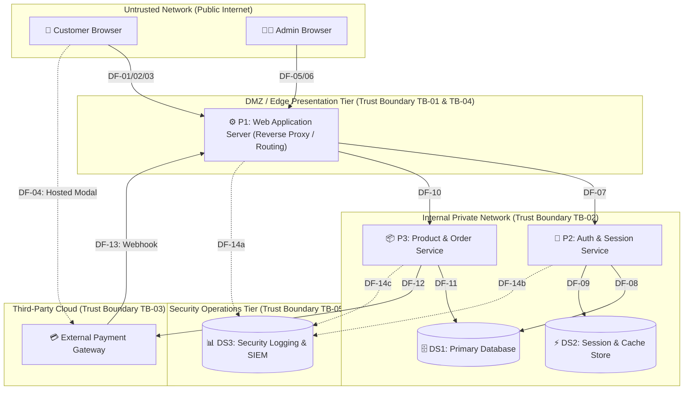

# 02. System Architecture & Data Flow Analysis: SecureShop

## Document Overview

| Attribute | Details |
| :--- | :--- |
| **Document** | System Architecture & Data Flow Specification |
| **System** | SecureShop E-Commerce Web Application |
| **Methodology** | Level 1 Data Flow Diagram (DFD) Architectural Decomposition |
| **Associated Diagram** | `diagrams/threat-model.mmd` & `diagrams/threat-model.png` |
| **Audience** | Cybersecurity Analysts, Software Engineers, Internship Evaluators |

---

## 1. Architectural Architecture Overview

To model security threats accurately, a cybersecurity engineer must first understand how an application is built, where data travels, and where different security privileges intersect. 

**SecureShop** is architected as a modular, three-tier e-commerce web platform backed by microservices for critical business operations and an external third-party integration for payment processing.

The system consists of **nine major architectural components**:
1. **External Customer (Browser)** — Untrusted public user client.
2. **System Administrator (Browser)** — Privileged corporate user client.
3. **Web Application Server (P1)** — Edge presentation, reverse proxy, routing, and session coordinator.
4. **Authentication & Session Service (P2)** — Identity management, credential verification, and token lifecycle engine.
5. **Product & Order Processing Service (P3)** — Business domain logic, catalog operations, and checkout state machine.
6. **Primary Relational Database (DS1)** — Persistent data storage for user records, catalog, and orders.
7. **Session & Cache Store (DS2)** — Low-latency in-memory data store for active session states and rate limits.
8. **Security Logging & SIEM Platform (DS3)** — Immutable event stream for security monitoring, telemetry, and auditing.
9. **External Payment Gateway** — Third-party PCI-DSS compliant processor handling credit card authorizations.



---

## 2. System Component Breakdown

### 2.1 External Entities

#### 1. External Customer (Client Browser)
- **Role**: Represents regular internet shoppers accessing SecureShop via desktop or mobile web browsers.
- **Capabilities**: Can browse public product catalogs, register accounts, authenticate, manage shipping profiles, assemble shopping carts, initiate purchases, and view personal past order histories.
- **Trust Level**: **Untrusted**. All inputs originating from customer clients must be treated as potentially malicious.

#### 2. System Administrator (Admin Workstation / Browser)
- **Role**: Represents internal corporate employees responsible for catalog curation, pricing updates, and order fulfillment.
- **Capabilities**: Can log into dedicated management routes, alter product inventory numbers, modify SKU pricing, review aggregate order queues, and issue customer refunds.
- **Trust Level**: **Semi-Trusted / Privileged**. Although administrators are authenticated employees, their workstations and accounts represent high-value targets for credential compromise and session hijacking.

#### 3. External Payment Gateway (Third-Party SaaS)
- **Role**: A certified external financial processor (e.g., Stripe, PayPal) operating within its own high-security PCI-DSS Level 1 infrastructure.
- **Capabilities**: Captures raw payment card information directly from the customer's browser, performs card verification, communicates with banking networks, issues cryptographically signed charge tokens, and delivers asynchronous webhook notices.
- **Trust Level**: **Third-Party Trusted (Bounded)**. Trusted for payment execution, but all webhook events received from the gateway must be cryptographically authenticated before being accepted.

---

### 2.2 Core Processes

#### 4. P1: Web Application Server (Reverse Proxy & Presentation Tier)
- **Role**: The internet-facing front line of SecureShop. Acts as a reverse proxy, web request router, template renderer, and TLS termination point.
- **Responsibilities**:
  - Enforces transport encryption (HTTPS / TLS 1.3).
  - Inspects incoming HTTP requests, applies HTTP security headers, and blocks malformed requests via basic WAF rules.
  - Terminates public user sessions and acts as an orchestration gateway to internal microservices.
  - Listens for and verifies incoming asynchronous webhooks from the payment gateway.
- **Execution Context**: Runs within a protected edge network (DMZ) with access limited to internal RPC channels.

#### 5. P2: Authentication & Session Management Service
- **Role**: The centralized security authority for the SecureShop application.
- **Responsibilities**:
  - Validates user login credentials against cryptographic password hashes stored in the database.
  - Implements multi-factor authentication (MFA) challenges for administrative users.
  - Generates, validates, refreshes, and revokes cryptographic session tokens and JWTs.
  - Tracks failed login attempts and coordinates account lockouts and rate limiting.
- **Execution Context**: Runs strictly within the private backend VPC network, accessible only via internal RPC from the Web Application Server.

#### 6. P3: Product Catalog & Order Processing Service
- **Role**: Executes the core business logic and transactional state machine of the e-commerce system.
- **Responsibilities**:
  - Handles catalog querying, keyword search, inventory availability checking, and price calculations.
  - Enforces server-side checkout logic: validates item prices against database ground truth (preventing client-side tampering).
  - Communicates outbound to the External Payment Gateway to register payment intents.
  - Transitions order states (e.g., `Pending Payment` $\to$ `Paid` $\to$ `Processing` $\to$ `Shipped`).
- **Execution Context**: Private backend VPC network. Direct access to the primary database.

---

### 2.3 Data Stores

#### 7. DS1: Primary Relational Database
- **Role**: The persistent single source of truth for the application.
- **Technologies**: Managed relational database (e.g., PostgreSQL or MySQL).
- **Contents**:
  - `Users Table`: User IDs, email addresses, names, shipping addresses, phone numbers, role definitions (`customer`, `admin`), password hashes, and cryptographic salts.
  - `Products Table`: Product IDs, SKU names, descriptions, categories, inventory stock levels, and authoritative retail prices.
  - `Orders Table`: Order IDs, customer user IDs, purchased SKU items, calculated tax, shipping fees, total amount, order lifecycle status, and opaque payment gateway charge reference IDs.
  - `Audit Table`: Transactional log of critical state transitions and administrative price overrides.
- **Security Posture**: Stored on encrypted block storage (AES-256); strict network access control allowlisting only P2 and P3 services; no direct public internet route.

#### 8. DS2: Session & Cache Store
- **Role**: High-speed, volatile in-memory key-value cache.
- **Technologies**: In-memory data store (e.g., Redis).
- **Contents**:
  - Active session identifiers mapped to user identities, role permissions, and expiration timestamps.
  - Token revocation lists (blocklists for logged-out JWTs).
  - Rate-limiting sliding-window counters (tracking requests per IP and per account).
- **Security Posture**: Isolated in the private VPC; encrypted in transit via TLS; password and ACL protected.

#### 9. DS3: Security Logging & SIEM Platform
- **Role**: Centralized repository for system telemetry, security event auditing, and anomaly detection.
- **Technologies**: Centralized log aggregation platform (e.g., Elastic Stack, AWS CloudWatch, Splunk).
- **Contents**:
  - Web application access logs (source IP, User-Agent, HTTP status, request duration).
  - Security audit events (successful logins, failed logins, password changes, MFA challenges, permission denials, role modifications).
  - Webhook delivery signatures and payment state transition traces.
- **Security Posture**: Append-only permissions; write access granted to services, read access restricted to security personnel; retained for 365 days for regulatory compliance and forensic investigations.

---

## 3. Data Flow Matrix

The following matrix documents every directional data flow across the SecureShop ecosystem, detailing the communication protocol, payload contents, data sensitivity classification, and traversed trust boundaries.

| Flow ID | Source Component | Destination Component | Protocol | Description & Payload Contents | Data Classification | Traversed Trust Boundary |
| :--- | :--- | :--- | :--- | :--- | :--- | :--- |
| **DF-01** | Customer Browser | Web Application (P1) | HTTPS / TLS 1.3 | Public catalog requests, user registration forms, login credentials (username/password), cart updates. | Restricted (Credentials), Public (Catalog) | **TB-01** (Public Internet Boundary) |
| **DF-02** | Web Application (P1) | Customer Browser | HTTPS / TLS 1.3 | Rendered HTML/JSON catalog pages, status messages, Set-Cookie session identifiers (`HttpOnly`, `Secure`). | Restricted (Session Cookie), Public (Content) | **TB-01** (Public Internet Boundary) |
| **DF-03** | Customer Browser | Web Application (P1) | HTTPS / TLS 1.3 | Checkout submission containing cart items, delivery address, and chosen shipping method. | Confidential (PII, Order Details) | **TB-01** (Public Internet Boundary) |
| **DF-04** | Customer Browser | Payment Gateway | HTTPS / TLS 1.3 | Direct transmission of raw credit card number, CVV, and expiry date via gateway-hosted modal or iframe. | **PCI-DSS Restricted** (Cardholder Data) | External Direct Flow (Bypasses SecureShop) |
| **DF-05** | Admin Browser | Web Application (P1) | HTTPS / TLS 1.3 | Admin credentials, MFA time-based one-time password (TOTP), catalog updates, price modifications, refund commands. | Restricted (Admin Credentials, TOTP, Commands) | **TB-04** (Admin Perimeter Boundary) |
| **DF-06** | Web Application (P1) | Admin Browser | HTTPS / TLS 1.3 | Administrative dashboard views, aggregate sales figures, order fulfillment queues, inventory management tables. | Confidential (Business Operations, Order Data) | **TB-04** (Admin Perimeter Boundary) |
| **DF-07** | Web Application (P1) | Auth Service (P2) | Internal RPC / mTLS | Inbound authentication requests, token verification checks, logout requests. | Restricted (Raw Credentials, Session Tokens) | **TB-02** (Internal Application Boundary) |
| **DF-08** | Auth Service (P2) | Primary Database (DS1) | Internal SQL / TLS | Queries to fetch salt and password hash; queries to verify account role (`admin` vs `customer`). | Restricted (Password Hashes, Salts, Roles) | **TB-02** (Internal Application Boundary) |
| **DF-09** | Auth Service (P2) | Session Store (DS2) | Internal TCP / TLS | Create new active session key, validate existing session token, increment rate-limit failure counters. | Restricted (Active Tokens, Session Keys) | **TB-02** (Internal Application Boundary) |
| **DF-10** | Web Application (P1) | Order Service (P3) | Internal RPC / mTLS | Dispatch order creation request, query customer order history, execute product catalog searches. | Confidential (Order Data, User ID) | **TB-02** (Internal Application Boundary) |
| **DF-11** | Order Service (P3) | Primary Database (DS1) | Internal SQL / TLS | Parameterized SQL queries to read product prices, decrement inventory stock, write new order records, read past orders. | Confidential (PII, Orders), Internal (Catalog) | **TB-02** (Internal Application Boundary) |
| **DF-12** | Order Service (P3) | Payment Gateway | HTTPS / TLS 1.3 (mTLS / API Key) | Server-to-server API call to generate Payment Intent with authoritative order amount and currency. | Confidential (Transaction Amount, Gateway Token) | **TB-03** (Third-Party SaaS Boundary) |
| **DF-13** | Payment Gateway | Web Application (P1) | HTTPS / TLS 1.3 (HMAC Webhook) | Asynchronous webhook notification stating payment result (`charge.succeeded` or `charge.failed`) with HMAC-SHA256 signature header. | Confidential (Payment Reference ID, Signature) | **TB-03** (Third-Party SaaS Boundary) |
| **DF-14a**| Web Application (P1) | Security SIEM (DS3) | Syslog over TLS / HTTPS | Edge HTTP access logs, blocked WAF requests, invalid HTTP method attempts, rate-limiting triggers. | Internal Security Telemetry | **TB-05** (Telemetry Boundary) |
| **DF-14b**| Auth Service (P2) | Security SIEM (DS3) | Syslog over TLS / HTTPS | Authentication audit records: successful logins, failed attempts, account lockouts, password resets, admin role elevations. | Internal Security Audit Log | **TB-05** (Telemetry Boundary) |
| **DF-14c**| Order Service (P3) | Security SIEM (DS3) | Syslog over TLS / HTTPS | Transaction audit events: order state changes, payment webhook processing results, admin price modifications. | Internal Security Audit Log | **TB-05** (Telemetry Boundary) |

---

## 4. Trust Boundaries & Security Enclaves

A **Trust Boundary** exists whenever data or control passes between two entities or networks that possess different levels of privilege, security policies, or administrative control. Identifying trust boundaries is the single most important step in STRIDE threat modeling because threats emerge primarily where boundaries are crossed.

```
+-----------------------------------------------------------------------------------------+
|                                UNTRUSTED PUBLIC INTERNET                                 |
|                                                                                         |
|   [ 👤 Customer Browser ]                       [ 👨‍💻 System Administrator Browser ]       |
+-----------------------------------------------------------------------------------------+
       | (DF-01, DF-03)                                      | (DF-05)
=======|=====================================================|=============================
       |   🔒 TRUST BOUNDARY TB-01 (Internet / DMZ)           | 🔒 TRUST BOUNDARY TB-04
=======v=====================================================v=============================
+-----------------------------------------------------------------------------------------+
|                                EDGE / DMZ PRESENTATION TIER                              |
|                                                                                         |
|   [ ⚙️ P1: Web Application Server (Reverse Proxy, Input Sanitization, Routing) ]          |
+-----------------------------------------------------------------------------------------+
       | (DF-07)                                             | (DF-10)
=======|=====================================================|=============================
       |   🔒 TRUST BOUNDARY TB-02 (Private Internal Application Network)
=======v=====================================================v=============================
+-----------------------------------------------------------------------------------------+
|                                INTERNAL PRIVATE VPC NETWORK                             |
|                                                                                         |
|   [ 🔐 P2: Auth & Session Service ]             [ 📦 P3: Product & Order Service ]       |
|            |                |                            |               |              |
|     (DF-08)|          (DF-09)|                     (DF-11)|         (DF-12)              |
|            v                v                            v               |              |
|   [ 🗄️ DS1: Database ]   [ ⚡ DS2: Cache Store ]   [ 🗄️ DS1: Database ]  |              |
+--------------------------------------------------------------------------|--------------+
       | (DF-14)                                                           |
=======|===================================================================|==============
       |   🔒 TRUST BOUNDARY TB-05 (Telemetry)                             | 🔒 TB-03
=======v===================================================================v==============
+-----------------------------------------------+   +-------------------------------------+
|        SECURITY & AUDIT TIER                  |   |      THIRD-PARTY SAAS NETWORK       |
|                                               |   |                                     |
|  [ 📊 DS3: Security Logging & SIEM Platform ] |   |  [ 💳 External Payment Gateway ]    |
+-----------------------------------------------+   +-------------------------------------+
```

### Trust Boundary Details

1. **Trust Boundary TB-01: Public Internet / DMZ Boundary**
   - **Separates**: Untrusted public customer clients from the SecureShop Web Application Server.
   - **Security Significance**: Represents the primary external attack surface. Any internet user can submit arbitrary HTTP payloads, automated vulnerability scans, SQL injection strings, or distributed denial of service floods across this boundary.
   - **Enforced Defenses**: TLS 1.3 encryption, Web Application Firewall (WAF) rule evaluation, rate limiting, and strict input validation.

2. **Trust Boundary TB-02: Internal Application Tier Boundary**
   - **Separates**: The internet-exposed Web Application Server from internal microservices (P2, P3) and persistent databases (DS1, DS2).
   - **Security Significance**: If the Web Application Server suffers remote code execution (RCE) or a server-side request forgery (SSRF) flaw, TB-02 prevents automatic, unauthenticated compromise of the underlying databases.
   - **Enforced Defenses**: Network firewall isolation (private VPC subnets), mutual authentication (mTLS / internal token auth), and parameterized database query interfaces.

3. **Trust Boundary TB-03: Third-Party Cloud Boundary**
   - **Separates**: SecureShop's internal infrastructure from the External Payment Gateway's cloud platform.
   - **Security Significance**: Outbound calls transmit transaction amounts; inbound webhook calls trigger order fulfillment. A malicious actor could attempt to spoof incoming webhooks to mark orders as "Paid" without providing funds.
   - **Enforced Defenses**: Outbound API key authentication; inbound HMAC-SHA256 signature verification on all webhook callbacks.

4. **Trust Boundary TB-04: Admin Privileged Access Boundary**
   - **Separates**: The administrative user's workstation from high-privilege management endpoints (`/admin/*`).
   - **Security Significance**: Administrative interfaces can modify product prices, view all customer PII, and cancel orders. An attacker compromising an admin session compromises the entire enterprise.
   - **Enforced Defenses**: Dedicated VPN or IP allowlisting, mandatory Multi-Factor Authentication (MFA), strict Role-Based Access Control (RBAC), and session timeout after 15 minutes of inactivity.

5. **Trust Boundary TB-05: Security Operations & Telemetry Boundary**
   - **Separates**: Application processes (P1, P2, P3) from the centralized SIEM and audit repository (DS3).
   - **Security Significance**: Audit logs must possess non-repudiation and integrity guarantees. An attacker who gains access to an application service must not be able to delete or modify historical access logs to hide their tracks.
   - **Enforced Defenses**: Append-only log shipping over TLS; write-only service accounts; strict separation of duties preventing application services from executing log truncation or deletion commands.

---

## 5. Sensitive Information Classification

Information processed within SecureShop is classified according to four sensitivity levels:

| Classification | Definition | Examples in SecureShop | Handling & Storage Requirements |
| :--- | :--- | :--- | :--- |
| **Restricted** | Highly sensitive credentials and keys whose compromise causes immediate catastrophic system takeover or fraud. | Password hashes, cryptographic salts, active session tokens, webhook HMAC secrets, admin MFA secrets. | Encrypted at rest (AES-256); masked in logs; never transmitted over plaintext; restricted memory access. |
| **Confidential** | Sensitive user or business data protected by privacy laws (GDPR, CCPA) or proprietary business value. | Customer PII (name, address, email, phone), order records, transactional amounts, customer purchase histories. | Encrypted in transit (TLS 1.3); encrypted at rest; access strictly authorized via server-side session checks. |
| **Internal** | Non-public operational data used for system diagnostics, performance, and monitoring. | Server access logs, WAF telemetry, inventory warehouse locations, application error metrics. | Stored within private network; access restricted to engineering and security operations staff. |
| **Public** | Information intended for unrestricted public consumption. | Product catalog descriptions, product marketing photos, public prices, general shipping policies. | Publicly cached via CDN; integrity verified to prevent unauthorized defacement or price tampering. |

---

## 6. External Dependencies & Supply Chain Considerations

SecureShop relies on several external hardware, software, and cloud dependencies that impact its overall security posture:

1. **Third-Party Payment Gateway API & SDK**:
   - The application embeds the gateway's client-side JavaScript SDK to generate payment tokens and relies on gateway webhooks.
   - *Risk*: If the third-party SDK is tampered with (supply-chain attack, e.g., Magecart), customer card data could be skimmed.
   - *Mitigation*: Enforce Content Security Policy (CSP) with Subresource Integrity (SRI) hashes and strict script-src allowlists.
2. **Open-Source Application Framework & Libraries**:
   - Web framework (e.g., Express.js, Django, or Spring Boot), ORM libraries, and cryptographic utility packages.
   - *Risk*: Known vulnerabilities (CVEs) in outdated dependencies could allow remote code execution or authentication bypass.
   - *Mitigation*: Automated Software Composition Analysis (SCA) in CI/CD (e.g., Dependabot, Snyk, npm audit).
3. **Container Runtime & Operating System**:
   - Docker container images and underlying Linux OS packages running microservices.
   - *Risk*: Container breakout vulnerabilities or privilege escalation in underlying kernel libraries.
   - *Mitigation*: Run containers as non-root users; enforce minimal scratch/Alpine base images; scan container images during build.

---

## 7. Beginner-Friendly Mentorship Section

### 7.1 Purpose of the Architecture Document
Before you can analyze how to break a system, you must understand how it is assembled. The **System Architecture Document** maps out the moving parts of the application, explains what each part does, traces how data travels, and marks where trust levels change.

### 7.2 Why It Matters
A security engineer who tries to find threats without an architecture document is essentially guessing in the dark. By creating a rigorous architectural decomposition:
- We can trace every single user interaction from browser to database.
- We can spot unencrypted channels or missing authentication checkpoints immediately.
- We can verify that high-privilege zones (like the database) are isolated from public zones.

### 7.3 How It Was Created
1. Identified every distinct component required for SecureShop to function as an e-commerce store.
2. Modeled data interactions into an explicit **Data Flow Matrix** (`DF-01` through `DF-14`).
3. Placed **Trust Boundaries** at every junction where data moves from an external, untrusted environment into an internal, higher-trust environment.
4. Categorized all processed information into clear data classification tiers.

### 7.4 How to Review This Document
- Confirm that every component in the architecture matches the nodes in `diagrams/threat-model.mmd`.
- Verify that every arrow in the diagram corresponds to a numbered flow (`DF-*`) in the Data Flow Matrix.
- Ensure that the trust boundaries are logically placed between networks with different privilege requirements.

---

### 7.5 Cybersecurity Reviewer Questions & Suggested Answers

**Q1: Why does the Web Application Server exist as an intermediary instead of letting browsers connect directly to the database or internal microservices?**
> *Answer:* Allowing client browsers to communicate directly with internal microservices or the database would eliminate network defense-in-depth and expose internal schemas and RPC ports directly to public internet attacks. The Web Application Server acts as a reverse proxy, traffic inspector, and gatekeeper. It enforces TLS, terminates untrusted HTTP requests, performs input validation, and limits internal exposure.

**Q2: What is the security purpose of separating the Session & Cache Store (DS2) from the Primary Database (DS1)?**
> *Answer:* Separation of concerns and performance isolation. The Session Store holds ephemeral, high-frequency active session tokens and rate-limit counters. Storing these in memory (e.g., Redis) prevents database connection pool exhaustion from high-volume session lookups and brute-force login attempts, while allowing independent access control policies.

**Q3: Why is Trust Boundary TB-05 (Telemetry Boundary) necessary if logging is internal?**
> *Answer:* In advanced cyberattacks, once adversaries compromise an application server, their first action is often to tamper with, truncate, or delete system log files to erase evidence of their breach. TB-05 ensures that the logging pipeline is write-only or append-only, preventing a compromised web server or application service from altering previously recorded forensic history in the SIEM.
