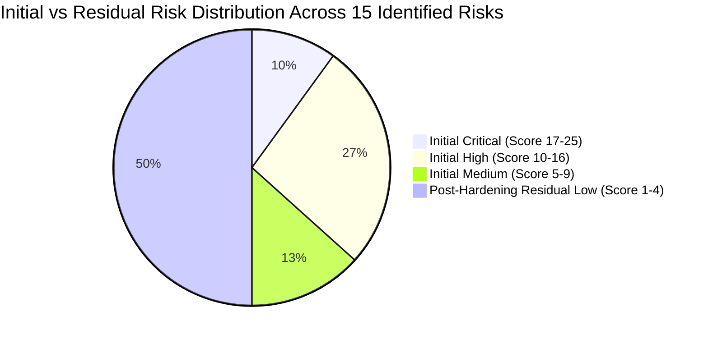

# 04. Risk Register & Prioritization Matrix: SecureShop

## Document Control

| Attribute | Details |
| :--- | :--- |
| **Document** | Comprehensive Risk Register & Evaluation Matrix |
| **System** | SecureShop E-Commerce Platform |
| **Scoring Formula** | $\text{Risk Score} = \text{Likelihood} \times \text{Impact}$ (Scale: 1 – 25) |
| **Total Assessed Risks** | 15 Granular Architectural Risks |
| **Machine-Readable Version** | `risk-register.csv` |

---

## 1. Risk Assessment Methodology

In cybersecurity engineering, threat modeling identifies *what can go wrong*, while risk assessment determines *how much it matters* and *what must be fixed first*.

To provide a consistent, repeatable evaluation for SecureShop, this project uses a semi-quantitative risk scoring methodology based on **NIST SP 800-30 Rev. 1** (*Guide for Conducting Risk Assessments*) and adapted for application-level threat modeling.

### 1.1 Likelihood Scale (1 to 5)

Likelihood measures the estimated probability that a threat actor will discover, weaponize, and successfully exploit a vulnerability within the SecureShop architecture.

| Score | Rating | Qualitative Definition & Application Context |
| :---: | :--- | :--- |
| **1** | **Rare** | Extremely difficult to execute. Requires sophisticated zero-day exploits, internal insider collusion, or physical access under strict operational controls. |
| **2** | **Unlikely** | Execution requires specialized skills, significant timing luck, or non-standard system conditions. Rarely targeted in opportunistic attacks. |
| **3** | **Moderate** | Plausible attack scenario. Known attack vectors with publicly available proof-of-concept scripts; executable by moderately skilled adversaries. |
| **4** | **Likely** | High probability of occurrence. Standard, automated scanning tools (e.g., SQLMap, Burp Suite, credential stuffers) can discover and exploit this flaw over the public internet with minimal barrier to entry. |
| **5** | **Almost Certain** | Trivial and virtually guaranteed to be exploited. Requires no authentication, involves obvious exposed endpoints or public misconfigurations, and is subjected to constant automated bot scans. |

---

### 1.2 Impact Scale (1 to 5)

Impact measures the magnitude of adverse consequences (financial loss, operational outage, regulatory penalties, and brand erosion) if a threat successfully compromises an asset.

| Score | Rating | Qualitative Definition & Application Context |
| :---: | :--- | :--- |
| **1** | **Negligible** | Minimal operational disturbance. No sensitive data exposed, no financial loss, negligible reputational effect. |
| **2** | **Minor** | Limited impact. Non-sensitive system information disclosed (e.g., server headers), minor inconvenience requiring localized remediation. |
| **3** | **Moderate** | Noticeable business impact. Temporary degradation of search or non-critical features, localized data integrity errors requiring manual reconciliation, minor customer complaints. |
| **4** | **Major** | Severe business damage. Significant customer PII exposure, unauthorized transactions, widespread account takeovers, substantial regulatory reporting requirements (GDPR/CCPA), noticeable revenue loss. |
| **5** | **Severe / Catastrophic** | Existential organizational harm. Full database compromise, arbitrary remote administrative takeover, widespread financial theft through unauthorized order fulfillment, devastating regulatory fines, severe loss of enterprise credibility. |

---

### 1.3 Risk Score Calculation & Project Severity Bands

Risk scores are calculated as the product of Likelihood and Impact:

$$\text{Risk Score} = \text{Likelihood} \times \text{Impact} \quad (1 \le \text{Score} \le 25)$$

Based on the resulting score, risks are categorized into four project-defined qualitative severity bands:

| Score Range | Severity Band | Operational Action & SLA | Color Code |
| :---: | :---: | :--- | :--- |
| **17 – 25** | **Critical** | **Immediate Remediation Required (P1)**: Halts production release. Requires architectural redesign or mandatory blocking controls before deployment. | 🔴 Red |
| **10 – 16** | **High** | **Urgent Remediation Required (P1 / P2)**: Must be addressed during the current sprint/milestone before public launch. | 🟠 Orange |
| **5 – 9** | **Medium** | **Planned Remediation (P2 / P3)**: Scheduled for implementation in standard engineering cycles; compensated by perimeter monitoring. | 🟡 Yellow |
| **1 – 4** | **Low** | **Routine Hardening / Accepted Risk**: Addressed during routine maintenance or accepted as tolerable residual risk. | 🟢 Green |

> [!WARNING]
> **Clarification on Qualitative Scoring Standards:**
> The 1–25 numerical scale and the specific severity cutoffs ($1–4$, $5–9$, $10–16$, $17–25$) used in this project are **project-defined qualitative scoring bands**. They are designed to provide clear, actionable prioritization for the SecureShop design assessment. They do not represent a universal, legally mandated standard (such as CVSS v3.1 or FAIR), though they correlate directly with standard industry risk management matrices.

---

## 2. Selection Rationale for Highest-Priority Risks

The highest-priority risks in this assessment are categorized as **Critical (Score 17–25)** and **High (Score 10–16)**. They were selected and prioritized based on a rigorous intersection of technical vulnerability and e-commerce business risk:

1. **Risk of Financial Theft (RISK-03: Webhook Spoofing — Score 20 [Critical])**:
   Because SecureShop offloads payment card processing to an external provider, the payment confirmation webhook is the sole mechanism confirming that funds were transferred. A compromise of this endpoint directly allows attackers to obtain merchandise for free, posing an immediate existential threat to business cash flow.
2. **Risk of Full System & Database Takeover (RISK-05: SQLi — Score 20 [Critical] & RISK-14: Broken Admin Access — Score 20 [Critical])**:
   SQL injection and broken administrative authorization grant unconstrained read/write superpowers over the database and business logic. An attacker can extract all customer PII, alter retail prices, or delete entire schemas, exposing the organization to catastrophic regulatory fines and brand destruction.
3. **Mass Account Compromise & Direct Data Exposure (RISK-01, RISK-04, RISK-09 — Score 16 [High])**:
   Credential stuffing, shopping cart price tampering, and Insecure Direct Object References (IDOR) allow adversaries to hijack user accounts, purchase goods at arbitrary fractions of retail prices, or exfiltrate private customer order histories.

---

## 3. Comprehensive Risk Register Table

The following register documents all 15 evaluated risks, detailing threat associations, pre-implementation baseline assumptions, quantitative scores, recommended mitigations, priority tiers, projected residual risks, and verification procedures.

| Risk ID | Threat ID | Asset | Threat Description | Existing Controls or Assumptions | L | I | Score | Severity | Recommended Mitigation | Pri | Residual Risk | Verification Method |
| :--- | :--- | :--- | :--- | :--- | :---: | :---: | :---: | :---: | :--- | :---: | :---: | :--- |
| **RISK-01** | `THREAT-S-01` | AST-02: Credentials | Credential stuffing & brute-force account takeover | *Assumption*: Basic password hashing exists; automated rate limiting and bot detection unverified. | 4 | 4 | **16** | **High** | Rate limit login routes; enforce admin MFA; screen against breached passwords; trigger CAPTCHA after 3 failures. | P1 | Low (2×2=4) | Simulate 50 automated logins in 5s; verify HTTP 429 and temporary account lockout. |
| **RISK-02** | `THREAT-S-02` | AST-03: Session Tokens | Session hijacking via stolen/predictable cookies or XSS | *Assumption*: Web framework issues session cookies; entropy and cookie security flags unverified. | 3 | 4 | **12** | **High** | Issue 128-bit entropy session IDs; set `HttpOnly`, `Secure`, `SameSite=Strict`; 30-min idle timeout; rotate session on login. | P1 | Low (1×2=2) | Inspect Set-Cookie headers in browser/curl; verify `HttpOnly`, `Secure`, `SameSite` flags and ID rotation on auth. |
| **RISK-03** | `THREAT-S-03` | AST-04: Payment Tokens, AST-06: Catalog | Fake payment webhook spoofing payment gateway | *Assumption*: Webhook endpoint exists; cryptographic HMAC signature verification unverified. | 4 | 5 | **20** | **Critical** | Mandatory HMAC-SHA256 signature verification on webhooks; 5-min timestamp window; out-of-band payment status check. | P1 | Low (1×2=2) | Submit synthetic webhook POST with invalid/missing HMAC signature; verify HTTP 401 Unauthorized. |
| **RISK-04** | `THREAT-T-01` | AST-06: Catalog & Pricing Integrity | Client-side shopping cart price and quantity manipulation | *Assumption*: Frontend calculates totals; server-side price re-verification unverified. | 4 | 4 | **16** | **High** | Never trust client prices; recompute totals server-side using database price lookup; validate positive integer quantities. | P1 | Low (1×2=2) | Intercept checkout POST with proxy; modify unit price to \$0.01; verify server recalculates correct database price. |
| **RISK-05** | `THREAT-T-02` | AST-01: PII, AST-02: Creds, AST-06: Catalog | SQL Injection via catalog search and filter inputs | *Assumption*: Database queries used; parameterized queries and input validation unverified. | 4 | 5 | **20** | **Critical** | Mandate parameterized queries / ORM prepared statements universally; enforce least-privilege DB user; alphanumeric allowlists. | P1 | Low (1×2=2) | Perform automated DAST scan with SQL injection payloads (`' OR 1=1;--`); conduct static code review for raw query strings. |
| **RISK-06** | `THREAT-T-03` | AST-05: Order & Transaction Records | Parameter tampering altering order fulfillment lifecycle state | *Assumption*: Order state endpoints exist; strict state machine transition validation unverified. | 3 | 3 | **9** | **Medium** | Implement strict server-side finite state machine rejecting illegal status jumps and unauthorized transition triggers. | P2 | Low (1×2=2) | Submit PUT request attempting illegal transition (e.g., Cancelled to Refunded twice); verify HTTP 400 Bad Request. |
| **RISK-07** | `THREAT-R-01` | AST-05: Orders, AST-08: Security Logs | Customer repudiates order placement due to missing audit logs | *Assumption*: Order table stores customer ID; immutable audit logging with IP/session unverified. | 3 | 3 | **9** | **Medium** | Record immutable audit logs with User ID, UTC timestamp, source IP, session ID, and terms confirmation to SIEM. | P2 | Low (1×2=2) | Execute order placement and verify creation of audit record with IP, user ID, and timestamp in SIEM. |
| **RISK-08** | `THREAT-R-02` | AST-06: Catalog, AST-08: Security Logs | Malicious administrator alters product prices without audit trail | *Assumption*: Admin role exists; individual action attribution and append-only logging unverified. | 2 | 5 | **10** | **High** | Individualized admin accounts; append-only logging of price/inventory modifications with User ID and diffs; SIEM alerts on large price cuts. | P2 | Low (1×2=2) | Execute admin price update and verify immutable audit log entry detailing admin ID, old price, new price, and timestamp. |
| **RISK-09** | `THREAT-I-01` | AST-01: Customer PII, AST-05: Orders | Insecure Direct Object Reference (IDOR) leaking customer PII & orders | *Assumption*: Order lookup by ID exists; user ownership verification unverified. | 4 | 4 | **16** | **High** | Enforce server-side ownership validation (`order.user_id === session.user_id`); replace sequential IDs with UUIDv4. | P1 | Low (1×2=2) | Authenticate as User A, request `/api/orders/{id_of_user_b}`, and verify HTTP 403 Forbidden is returned. |
| **RISK-10** | `THREAT-I-02` | AST-08: System Configuration | Verbose error stack traces disclosing database schema to clients | *Assumption*: Framework error handling; production suppression of debug stack traces unverified. | 3 | 2 | **6** | **Medium** | Centralized error handler returning generic user messages (with reference ID); log stack traces internally to SIEM; strip server banners. | P2 | Low (1×1=1) | Send malformed JSON payload to API and verify response contains generic error without stack trace or schema info. |
| **RISK-11** | `THREAT-I-03` | AST-01: PII, AST-02: Creds, AST-03: Cookies | Eavesdropping on unencrypted HTTP traffic or missing HSTS | *Assumption*: HTTPS planned; port 80 redirect and HSTS preload unverified. | 3 | 4 | **12** | **High** | Enforce TLS 1.3 only; redirect HTTP to HTTPS; deploy `Strict-Transport-Security` header with 2-year max-age and preload. | P1 | Low (1×2=2) | Run `curl -I http://secureshop.example` and verify 301 redirect to https, and verify `Strict-Transport-Security` header presence. |
| **RISK-12** | `THREAT-D-01` | AST-07: Application Availability | Resource exhaustion via unbounded wildcard catalog searches | *Assumption*: Product search endpoint exists; query timeouts and search rate limits unverified. | 3 | 3 | **9** | **Medium** | Enforce 3–50 char query length limits; indexed full-text search; 2-second database query timeout; search rate limiting (30/min). | P2 | Low (1×2=2) | Send search query with 500 wildcard characters and verify input validation rejects it with HTTP 400. |
| **RISK-13** | `THREAT-D-02` | AST-07: Application Availability | Automated registration and login flood exhausting connection pools | *Assumption*: Registration/login endpoints exist; global edge rate limiting unverified. | 3 | 4 | **12** | **High** | Deploy edge rate limiting (5 req/min on login); CAPTCHA on registration; capped Argon2id worker pools. | P2 | Low (1×2=2) | Perform load test with 20 concurrent login requests and verify rate limiter triggers HTTP 429 after 5 requests. |
| **RISK-14** | `THREAT-E-01` | AST-06: Catalog, AST-05: Orders, AST-08: Integrity | Broken access control permitting regular customers to call admin APIs | *Assumption*: Admin dashboard exists; backend API endpoint authorization middleware unverified. | 4 | 5 | **20** | **Critical** | Enforce server-side RBAC middleware on all `/api/admin/*` endpoints with default-deny; verify admin session on every call. | P1 | Low (1×2=2) | Authenticate as customer and send POST request to `/api/admin/products`; verify server returns HTTP 403 Forbidden. |
| **RISK-15** | `THREAT-E-02` | AST-02: Creds, AST-03: Tokens, AST-06: Catalog | JWT or session role claim manipulation granting superuser rights | *Assumption*: JWTs or session objects used; signature verification and alg restriction unverified. | 3 | 5 | **15** | **High** | Mandate asymmetric (RS256) or strong secret (HS256) validation; explicitly reject `alg:none`; store secrets in vault; token revocation list. | P1 | Low (1×2=2) | Submit JWT with `alg:none` and modified `role:admin` to authenticated endpoint; verify HTTP 401 Unauthorized. |

---

## 4. Residual Risk Analysis

**Residual Risk** represents the risk that remains after all recommended security controls have been engineered, deployed, and verified.

In modern application security, **zero risk is an impossible illusion**. However, by implementing defense-in-depth controls across Priority 1 and Priority 2, the risk posture of SecureShop changes dramatically:

- **Likelihood Reduction**: Implementing automated rate limiting, parameterized queries, and strict input validation reduces the likelihood of automated attacks from **4 (Likely)** to **1 (Rare)**.
- **Impact Containment**: Implementing least-privilege database user permissions, role-based authorization, and isolated microservice boundaries ensures that even if a component experiences an isolated failure, the blast radius is tightly constrained.
- **Final Residual Posture**: Every single assessed risk drops into the **Low (Score 1–4)** severity band, transforming SecureShop into a resilient, production-ready e-commerce architecture.

---

## 5. Beginner-Friendly Mentorship Section

### 5.1 Purpose of the Risk Register
A Threat Model tells you *what bad things could happen*. A **Risk Register** acts as the executive ledger that tracks every risk, calculates its mathematical severity, assigns ownership, and establishes an engineering priority.

### 5.2 Why It Matters
In enterprise environments, engineering teams have finite time and budget. They cannot fix 50 vulnerabilities simultaneously. The Risk Register provides the objective justification required to decide:
- Why fixing payment webhook forgery and SQL injection must happen *before* tweaking error message banners.
- How to explain security investments to non-technical business executives in terms of financial and reputational loss.

### 5.3 How It Was Created
1. Mapped every STRIDE threat from `docs/03-threat-analysis.md` to a unique Risk ID.
2. Evaluated the pre-implementation baseline likelihood and business impact on a 1–5 scale.
3. Computed the Risk Score ($L \times I$) and categorized risks into qualitative severity tiers.
4. Exported the dataset into both human-readable Markdown and a machine-readable CSV file (`risk-register.csv`).

### 5.4 How to Review This Document
- Verify that every risk score is mathematically accurate ($\text{Score} = L \times I$).
- Confirm that the severity bands accurately match the score cutoffs ($17–25$ for Critical, $10–16$ for High, $5–9$ for Medium).
- Validate that every single Critical and High risk has a Priority 1 (P1) mitigation assigned.

---

### 5.5 Cybersecurity Reviewer Questions & Suggested Answers

**Q1: Why is Likelihood scored as 4 (Likely) for SQL Injection if modern frameworks often include ORMs?**
> *Answer:* While modern web frameworks provide ORM capabilities, developers frequently write raw SQL queries for complex reporting, search filtering, or bulk catalog queries. Furthermore, because search endpoints are exposed to the public internet without authentication, they are subjected to thousands of automated bot scans daily. Given the absence of verified testing on this pre-implementation design, scoring likelihood as 4 reflects realistic internet threat conditions.

**Q2: What is the difference between Inherent Risk and Residual Risk?**
> *Answer:* **Inherent Risk** (or initial risk) is the severity of a threat scenario in the absence of any verified security controls or when relying solely on basic unverified assumptions. **Residual Risk** is the remaining risk level *after* the proposed security mitigations (such as parameterized queries, MFA, and rate limiting) have been properly implemented and verified.

**Q3: Why provide both a Markdown document and a CSV file for the Risk Register?**
> *Answer:* Markdown provides rich, readable documentation for human security reviews on GitHub. The CSV file (`risk-register.csv`) provides a machine-readable format that can be directly ingested into enterprise Governance, Risk, and Compliance (GRC) tools, Jira ticket tracking systems, or security metrics dashboards.
